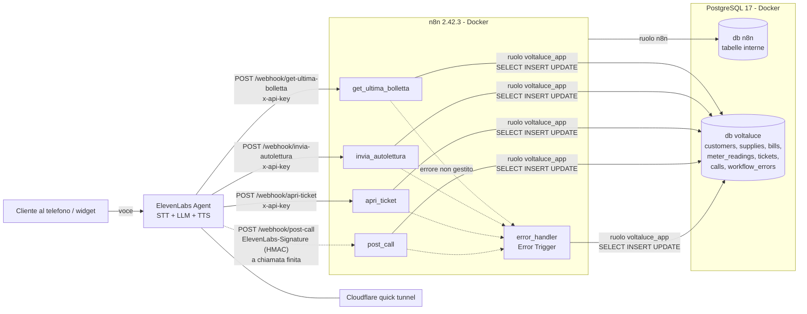
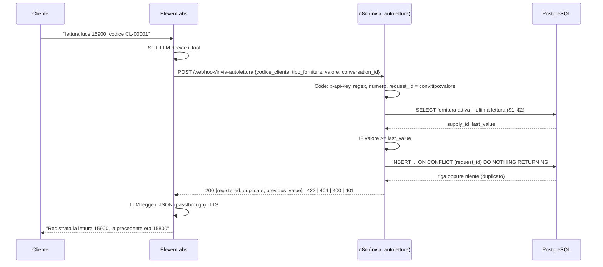
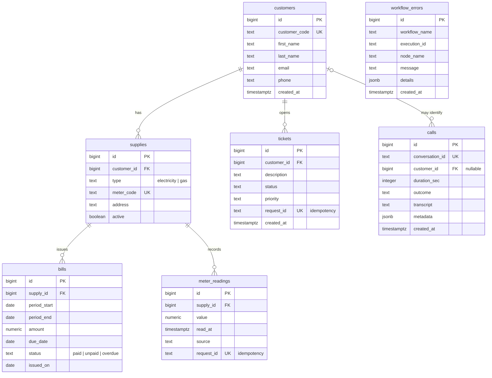

# Architettura

## Componenti

## Flusso di un tool call

## Modello dati

## Scelte tecniche

| Scelta | Motivo | Alternativa scartata |
|---|---|---|
| Due database Postgres (`n8n`, `voltaluce`) nello stesso container | n8n possiede il suo schema con decine di tabelle migrate automaticamente; il ruolo dei workflow non può nemmeno vedere quelle tabelle | Due schemi nello stesso database: isolamento più debole |
| Ruolo `voltaluce_app` senza `DELETE` | I dati di una utility si disattivano, non si cancellano; l'agente vocale non può distruggere nulla | Ruolo owner delle tabelle |
| `ON DELETE RESTRICT` ovunque, `SET NULL` su `calls` | Bollette e letture hanno valore fiscale; la FK vive sul figlio e protegge il padre | `CASCADE`: un `DELETE` sbagliato cancellerebbe lo storico |
| Autenticazione dei tool nel Code node | 401 con body JSON coerente; un solo nodo per auth e validazione | Header Auth nativa: 403 generico, ma rifiuta prima di creare l'esecuzione (meglio in produzione, al bordo) |
| Idempotenza con `request_id` derivato da `conversation_id` | ElevenLabs non espone un id per tool call; la chiave identifica l'intenzione (stessa conversazione, stessa fornitura, stesso valore) | Chiave generata dall'LLM: inaffidabile |
| `ON CONFLICT DO NOTHING RETURNING` | Un solo statement dice se ha inserito; rende sicuri i retry | `SELECT` poi `INSERT`: race condition |
| Date castate `::text` nelle query | Il driver `pg` trasformerebbe `DATE` in `Date` JavaScript e la serializzazione UTC può spostare il giorno | Convertire nel Code node |
| Status code HTTP semantici + `passthrough` nei tool ElevenLabs | Status per le macchine (log, retry), body per l'LLM; senza passthrough i 4xx arrivano all'LLM come errore generico | Rispondere sempre 200 con `ok:false` |
| Campo `say_to_customer` nelle risposte di errore | L'LLM parafrasava male i messaggi tecnici; una frase pronta in italiano riduce le invenzioni | Solo `message` tecnico |
| HMAC sul post-call, API key sui tool | Il post-call lo firma ElevenLabs con il suo schema; per i tool definiamo noi il contratto | Nessuna verifica: endpoint aperto a payload inventati |
| Error workflow che scrive in `workflow_errors` senza FK | Deve funzionare anche se le tabelle applicative sono rotte | Log solo in n8n: non interrogabile via SQL |
| Cloudflare quick tunnel con `--protocol http2` | Nessun account, un comando; QUIC cadeva sulla rete domestica | ngrok (account, interstitial), named tunnel (dominio) |

## Debug di una catena distribuita

Ogni chiamata lascia tracce in quattro posti collegati da un identificativo comune, il `conversation_id` di ElevenLabs:

1. **ElevenLabs**: storico conversazioni con trascrizione e tool call.
2. **n8n**: esecuzioni (solo quelle fallite sono salvate), con input e output di ogni nodo.
3. **PostgreSQL**: `meter_readings.request_id` e `tickets.request_id` contengono il `conversation_id`; `calls.conversation_id` è la chiave; `workflow_errors.details.execution_url` punta all'esecuzione n8n.
4. **Tunnel**: il log di cloudflared mostra se la richiesta è arrivata.

Metodo usato durante lo sviluppo: partire dal sintomo (l'agente dice "errore tecnico"), verificare se la richiesta è arrivata a n8n (esecuzioni, tabella), poi al tunnel (log), poi all'agente (versione pubblicata). Ogni volta il problema era nel livello più esterno non ancora verificato.
